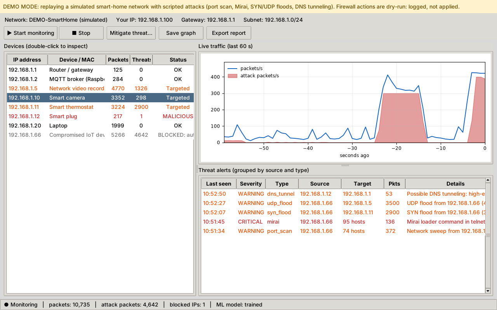
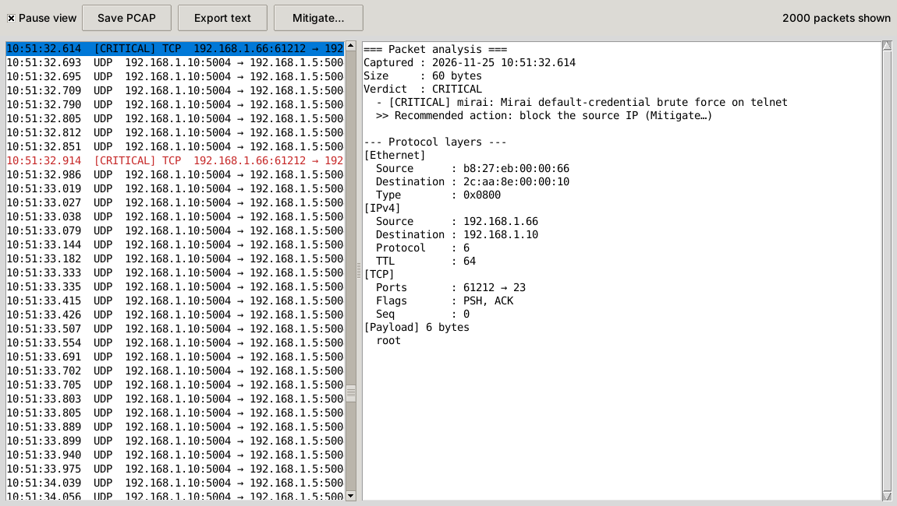
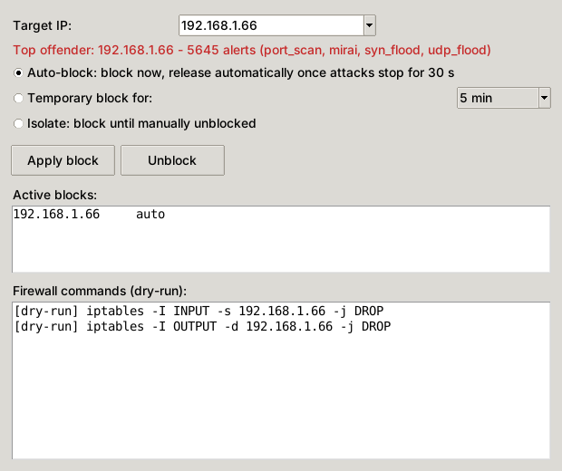
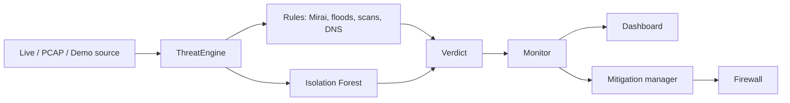

# IoT Guard: AI-Driven Real-Time Anomaly Detection & Risk Mitigation for IoT Networks

[](https://github.com/AkhilSampathVinay/AI-Driven-Real-Time-Anomaly-Detection-and-Risk-Mitigation-in-IoT-Network/actions)


A desktop network-security tool that watches IoT traffic in real time, detects
attacks with a **hybrid of signature rules and an unsupervised ML model
(Isolation Forest)**, and can **block attackers on the firewall automatically**,
releasing them again once they go quiet.

Built with **Python, Scapy, scikit-learn, Tkinter and Matplotlib**. Started as my
B.Tech (CSE – Cyber Security) major project and later refactored into a tested
package.



## Try it in 1 minute (no root, no IoT devices needed)

```bash
git clone https://github.com/AkhilSampathVinay/AI-Driven-Real-Time-Anomaly-Detection-and-Risk-Mitigation-in-IoT-Network.git
cd AI-Driven-Real-Time-Anomaly-Detection-and-Risk-Mitigation-in-IoT-Network
python -m venv .venv && source .venv/bin/activate   # Windows: .venv\Scripts\activate
pip install -e .
iot-guard demo
```

Demo mode replays a **simulated smart home** (camera, thermostat, smart plug,
NVR, laptop) with a compromised device that runs, in order: a port scan, a
**Mirai botnet** telnet scan and brute force, a SYN flood, a UDP flood, and DNS
tunneling. Watch the alerts appear, double-click a device to inspect its packets,
and open **Mitigate threat…** to block the attacker (in demo mode firewall
commands are shown, not executed).

> On Linux, if you get `No module named tkinter`, run `sudo apt install python3-tk`.

## What it detects

| Threat | How | Severity |
|---|---|---|
| **Mirai botnet** | Scanner fingerprint (TCP `seq == destination IP`), default telnet credentials from Mirai's dictionary, busybox/wget loader commands, known exploit URLs | CRITICAL |
| **SYN flood** | SYN-without-ACK rate per source → target service, sliding window | WARNING |
| **UDP flood** | UDP packet rate per source → target, sliding window | WARNING |
| **Port scan / network sweep** | distinct ports per host, or distinct local hosts per port, in 10 s | WARNING |
| **DNS tunneling** | high-entropy long DNS labels, abnormal query rate per domain | WARNING |
| **Unknown / zero-day behaviour** | Isolation Forest learns normal traffic (size, timing, protocol, port class, flags) and scores every packet | NOTICE |

## Risk mitigation

- **Auto-block**: block now, release automatically once the IP has sent no attack traffic for a quiet period
- **Temporary block**: 1 min to 24 h, expires on its own
- **Isolate**: block until manually unblocked
- Works with `iptables` (Linux), `netsh advfirewall` (Windows) and `pf` (macOS)
- **Safe by default**: dry-run unless you pass `--enforce`. IPs are validated before use, the gateway and your own IP are protected, and every rule is removed on exit.

## Results

`iot-guard evaluate` replays ~15k labelled packets (benign smart-home traffic + the 5 attacks):

| Detector | Precision | Recall | False-positive rate on benign |
|---|---|---|---|
| Rules (WARNING / CRITICAL) | **1.00** | 0.92 | **0.0 %** |
| Isolation Forest (NOTICE)  | 0.90 | 0.47 | 4.9 % |

| Attack | Caught by rules | Caught by ML | Alert raised after |
|---|---|---|---|
| Port scan  | 93 % | 100 % | 0.6 s |
| Mirai      | 97 % | 89 %  | instant (first packet) |
| SYN flood  | 97 % | 100 % | 0.3 s |
| UDP flood  | 88 % | **0 %** | 1.3 s |
| DNS tunnel | 100 % | 100 % | instant |

**Why hybrid?** The ML model never sees the UDP flood, because its packets look
just like the camera's video stream. A rate rule catches it immediately. The ML
model, meanwhile, flags unusual behaviour that no rule was written for. Rules give
precise, explainable alerts that are safe to act on automatically; ML adds
coverage for the unknown.

> These numbers come from **synthetic** traffic (see `simulator.py`), so they show
> the detectors work as designed, not real-world accuracy. Evaluating on public
> IoT datasets such as CIC-IoT-2023 or N-BaIoT is on the roadmap.

v2 compared with the original prototype on the same traffic: benign false alarms
went from **99.8 % to 0 %**, and the UDP flood went from missed to detected. See
[CHANGELOG](docs/CHANGELOG.md).

## Usage

```bash
iot-guard demo [--speed 2]          # GUI, simulated network (safe)
sudo iot-guard live                 # GUI, real network, mitigation in dry-run
sudo iot-guard live --enforce       # ...and actually apply firewall rules
iot-guard generate attack.pcap      # write the scenario to a PCAP (open it in Wireshark)
iot-guard analyze attack.pcap       # headless threat report for any capture
iot-guard evaluate                  # precision / recall / time-to-detect
```

<details>
<summary>Example <code>analyze</code> output</summary>

```
 Packets analysed : 15,088
 Processing time  : 6.9 s (2,191 packets/s)

 Verdicts:
   NORMAL      7,706
   NOTICE        504
   WARNING     6,742
   CRITICAL      136

 First occurrence of each threat:
   +   60.6s  port_scan   Port scan from 192.168.1.66: 21 ports on 192.168.1.10 in 10s
   +   80.0s  mirai       Mirai scanner fingerprint (seq == dst IP) on port 23
   +  120.3s  syn_flood   SYN flood from 192.168.1.66 (303 SYN/s)
   +  141.2s  udp_flood   UDP flood from 192.168.1.66 (401 pkt/s)
   +  160.0s  dns_tunnel  Possible DNS tunneling: high-entropy label (47 chars)

 Top offending IPs:
   192.168.1.66     CRITICAL    6908 alerts  (udp_flood=3500, syn_flood=2900, port_scan=372, mirai=136)
   192.168.1.12     WARNING       60 alerts  (dns_tunnel=60)
```
</details>

Live mode needs root/Administrator (and [Npcap](https://npcap.com/) on Windows).
See [docs/SETUP.md](docs/SETUP.md) for platform notes.

## Screenshots

| Packet inspector | Mitigation |
|---|---|
|  |  |

## How it works



Design notes (thread safety, model-poisoning protection, why the Mirai
`seq == dst IP` fingerprint works, and more) are in
[docs/ARCHITECTURE.md](docs/ARCHITECTURE.md).

```
src/iot_guard/
├── detection/   rules.py · ml.py · engine.py · verdict.py
├── gui/         app.py · format.py
├── mitigation.py  monitor.py  sources.py  scanner.py  simulator.py  report.py
tests/           29 tests (detectors, engine, mitigation, CLI, sources)
legacy/          original v1 prototype, kept for reference
```

## Development

```bash
pip install -e ".[dev]"
pytest          # 29 tests, ~1 min
ruff check src tests
```

## Limitations

- On a switched or Wi-Fi network a computer only sees its own traffic plus
  broadcasts. To monitor every device, run it on the gateway, a mirrored switch
  port, or a Raspberry Pi acting as the access point.
- Blocking happens on the host firewall, so it cuts the attacker off from *this
  machine*. Network-wide isolation needs the tool on the router or an integration
  with it.
- IPv4 only. Encrypted payloads (TLS) aren't inspected; detection relies on
  metadata and rates.
- Thresholds are tuned for a home or small-office network (`config.py`).

## Roadmap

- Evaluate on public datasets (CIC-IoT-2023, N-BaIoT, TON_IoT)
- Per-device behaviour models instead of one network-wide model
- Router integration (OpenWrt) for network-wide isolation
- Web dashboard and alert notifications

## License

MIT. See [LICENSE](LICENSE).
