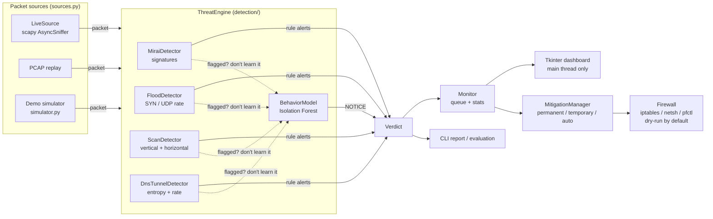

# Architecture



## Data flow

1. A **source** delivers packets on a background thread. All sources share one
   interface, so the engine doesn't know or care whether the traffic is live,
   replayed or simulated.
2. **ThreatEngine.analyze(packet)** runs every detector and returns a `Verdict`
   (severity + list of alerts). Detectors use sliding windows keyed on *packet
   timestamps*, so a PCAP replay gives exactly the same result every time.
3. The **Monitor** puts `(packet, verdict)` into a bounded queue. The GUI drains
   that queue every 200 ms **on the Tk main thread**. Tkinter isn't thread-safe,
   and touching widgets from capture threads was a source of random crashes in
   v1.
4. **MitigationManager** keeps the block list. `tick()` runs every second to
   expire temporary blocks and release auto-blocks once the attacker has been
   quiet for the configured period.

## Severity model

| Level    | Raised by                                    | Meaning                       |
|----------|----------------------------------------------|-------------------------------|
| CRITICAL | Mirai signatures                             | known malware: act now        |
| WARNING  | flood / scan / DNS-tunnel rules              | attack behaviour              |
| NOTICE   | Isolation Forest                             | unusual: worth a look         |
| BLOCKED  | traffic from an IP that is currently blocked |                               |

The ML model reports at NOTICE level on purpose. On its own it has a ~5% false
positive rate on benign traffic (see `iot-guard evaluate`), which is too noisy to
drive automatic blocking. The rules have 0% false positives on the same data, but
they only catch what they were written for. Using both gives explainable,
high-confidence alerts plus a signal for unknown behaviour.

## Why some design choices

| Choice | Reason |
|---|---|
| Mirai `seq == dst IP` fingerprint | Mirai's scanner reuses the target address as the TCP sequence number. Normal stacks randomise it, so this is a near-zero false-positive indicator. |
| SYN flood keyed on `(src, dst, dport)` | A flood hammers one service. Keying on the port keeps port scans from being mislabelled as floods. |
| Horizontal scans counted only for private destinations | A browser opening many HTTPS connections to internet hosts is normal. |
| ML retrains only on traffic no detector flagged | Prevents *model poisoning*, where a long attack would otherwise get learned as normal. |
| Score cache in the ML model | sklearn costs ~5 ms per single-sample call. Network features repeat a lot, so caching on a rounded feature vector cut analysis time ~10×. |
| Firewall dry-run by default, IP validated with `ipaddress` | Never run shell commands built from unvalidated strings, and never change a machine's firewall without being asked to explicitly. |
| Rules removed on exit (`release_all`) | Don't leave a user's machine with blocking rules nobody remembers adding. |

## Module map

```
src/iot_guard/
├── __main__.py        CLI (demo | live | analyze | generate | evaluate)
├── config.py          thresholds and Mirai signatures
├── detection/
│   ├── verdict.py     Severity, Alert, Verdict
│   ├── rules.py       Mirai, flood, scan, DNS-tunnel detectors
│   ├── ml.py          feature extraction + Isolation Forest
│   └── engine.py      ThreatEngine + offender tracking
├── mitigation.py      Firewall backends + MitigationManager
├── monitor.py         source → engine → queue → GUI glue (no Tk)
├── sources.py         live / PCAP / demo packet sources
├── scanner.py         network info + ARP scan
├── simulator.py       labelled synthetic IoT traffic + attacks
├── report.py          headless PCAP report + evaluation
└── gui/
    ├── app.py         dashboard, device inspector, mitigation dialog
    └── format.py      packet summaries / layer breakdown
```
